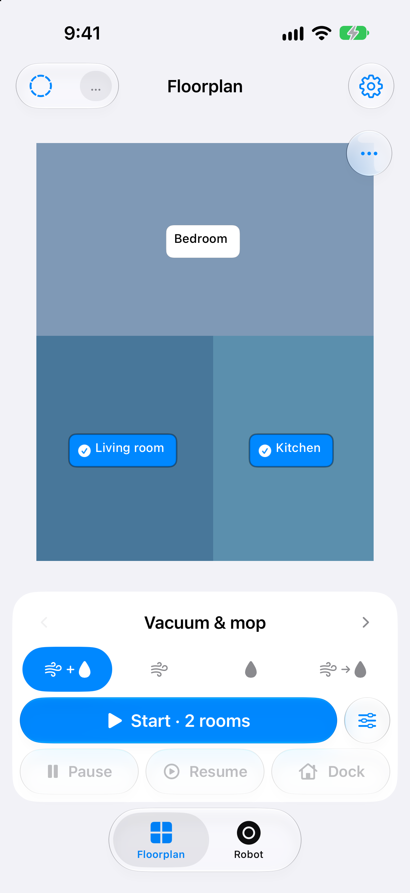
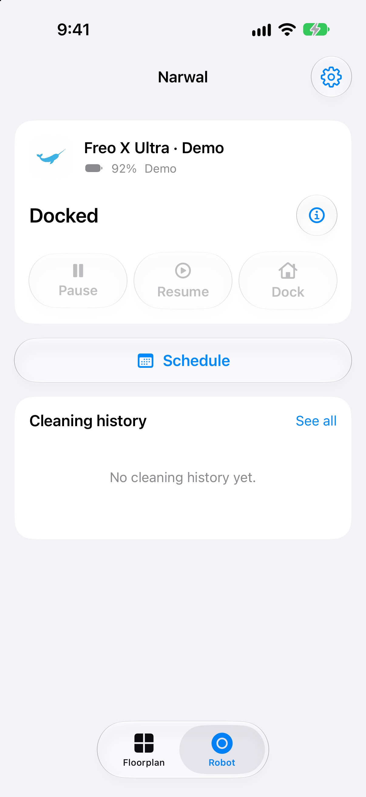

# Freo Control for iPhone

An independent, native SwiftUI iOS app (`iOS 17+`) for controlling a US **Narwal Freo X Ultra** robot vacuum and mop directly from an iPhone—with zero third-party Swift packages, native Apple Shortcuts & Siri support (including Lock Screen and HomePod execution), live MQTT floorplan telemetry, cleaning history, schedules, and room boundary editing.

> **Disclaimer:** This is an independent open-source project and is not affiliated with, endorsed by, or supported by Narwal.

<p align="center">
  
  &nbsp;&nbsp;
  
</p>

---

## Features

- **Direct Native Connection**: Connects directly from the iPhone to Narwal's US cloud endpoints (`us-app.narwaltech.com:443` and `us-01.mqtt.narwaltech.com:8883`) using Apple's `Network.framework` with TLS certificate validation and IPv4 US endpoint verification. No external bridge, Home Assistant instance, or always-on Mac is required.
- **Floorplan & Cleaning Controls**:
  - Interactive raster floorplan rendering with tap-to-select rooms, active task outlines, and live robot position/trajectory overlays.
  - Horizontal swipe mode picker for **Vacuum**, **Mop**, **Vacuum & mop**, and **Vacuum, then mop**.
  - Configurable cleaning options (1 or 2 passes, suction level, mop moisture, and path preference).
  - One-tap **Start**, **Pause**, **Resume**, and **Dock** (stop and return to base station) controls.
- **Siri & Apple Shortcuts (Lock Screen & HomePod Ready)**:
  - Built with `AppIntents` (`openAppWhenRun = false`, `authenticationPolicy = .alwaysAllowed`) so shortcuts run directly in the background without unlocking the iPhone and work via HomePod Personal Requests.
  - **Per-mode room shortcuts**: *"Vacuum [Room] with Narwal"*, *"Mop [Room] with Narwal"*, *"Vacuum and mop [Room] with Narwal"*, and *"Vacuum then mop [Room] with Narwal"*.
  - **Pause & Stop shortcuts**: *"Pause Narwal"* (`PauseRobotIntent` → `task/pause`) and *"Stop Narwal"* / *"Dock Narwal"* (`StopRobotIntent` → `supply/recall`).
  - **Multi-room action**: The **Clean rooms** action in the Apple Shortcuts app accepts any cleaning mode and one or more saved rooms.
  - Automatic active-task replacement: starting a new room clean via Siri while the robot is already cleaning automatically recalls the robot to the dock, waits for confirmed standby, and dispatches the new room clean.
- **Live Telemetry & Cleaning History**:
  - Scoped MQTT live trajectory streaming while viewing the **Floorplan** tab, with automatic fallback polling.
  - On-demand cloud work-history sync and local route excerpt caching (bounded to 20 records, 30 days, or 48 MiB, excluded from iCloud backups).
- **Weekly Schedules**:
  - View, create, edit, toggle, and delete weekly room-cleaning schedules in the robot's verified local timezone.
- **Room Rename, Merge & Boundary Editor**:
  - Rename rooms, merge adjacent rooms, or split rooms with verified `/map/operation` transactions, automatic pre-write snapshots, and cell-by-cell readback validation.
- **Demo Mode**:
  - Built-in offline synthetic floorplan and robot state for exploring the UI without signing in or sending network requests.

See [PARITY.md](PARITY.md) for a detailed comparison with the official Narwal Freo X Ultra feature set.

---

## Requirements & Installation

1. **Xcode 16+** and an iPhone running **iOS 17.0 or later**.
2. Open `FreoControl.xcodeproj` in Xcode (there are no external SPM dependencies to fetch).
3. In Xcode, select the **FreoControl** project → **FreoControl** target → **Signing & Capabilities**:
   - Select your personal Apple Developer / Apple ID **Team**.
   - Change `PRODUCT_BUNDLE_IDENTIFIER` (`com.freo.personal.control`) to a unique bundle identifier if Xcode reports that the identifier is already registered.
4. Connect your iPhone, select it as the run destination, and click **Run**.

### Signing In

- Tap the **gear icon** to open **Connection**.
- Sign in using the email address and **Narwal account password** associated with your US Narwal account. (If your account was created with "Continue with Apple" or email verification codes, set a password first in the official Narwal app under *Account Settings → Reset Password*.)
- Session tokens are stored locally in the iPhone Keychain using `kSecAttrAccessibleAfterFirstUnlockThisDeviceOnly` (never synced to iCloud, and available to background Siri / Shortcuts requests after the first device unlock following a reboot). Your password is never stored.

---

## Siri & Shortcuts Guide

After signing in and loading your floorplan at least once, Freo Control caches your room catalog locally so Siri and Shortcuts can resolve rooms in the background.

### Built-in Voice Phrases
- *"Siri, vacuum [Room] with Narwal"*
- *"Siri, mop [Room] with Narwal"*
- *"Siri, vacuum and mop [Room] with Narwal"*
- *"Siri, vacuum then mop [Room] with Narwal"*
- *"Siri, pause Narwal"*
- *"Siri, stop Narwal"* or *"Siri, dock Narwal"*

### Custom Personal Shortcuts (Without Saying "Narwal")
In the Apple **Shortcuts** app, you can create 1-action personal shortcuts using the **Narwal** actions (**Vacuum Room**, **Mop Room**, **Vacuum and Mop Room**, **Vacuum then Mop Room**, **Clean Rooms**, **Pause Robot**, or **Stop Robot**) and name them whatever you like—for example:
- `"Vacuum Kitchen"`
- `"Mop Living Room"`
- `"Pause Robot"`
- `"Stop Robot"`

Because all intents run in the background (`openAppWhenRun = false`), these personal shortcuts work hands-free while your iPhone is locked and from a HomePod on the same Apple ID.

---

## Privacy & Security

- **Pinned US Endpoints**: Traffic only connects to `us-app.narwaltech.com:443` and `us-01.mqtt.narwaltech.com:8883` over TLS, rejecting proxies, redirects, and non-US IPv4 destination records.
- **Local-Only Storage**:
  - Session tokens are kept in the device-only Keychain (`kSecAttrAccessibleAfterFirstUnlockThisDeviceOnly`).
  - Cached floorplans, route history, and pre-write map snapshots are stored in private Application Support directories with file protection and `isExcludedFromBackup = true`.
  - No third-party SDKs, analytics, crash reporters, or external assets are included.

---

## Building & Running Tests

### 1. Offline Core Test Suite (SwiftPM)
Runs protocol, codec, map geometry, schedule, trajectory, policy, and session vault unit tests without a robot or network connection:

```sh
DEVELOPER_DIR=/Applications/Xcode.app/Contents/Developer swift test
```

### 2. Offline AppIntents & Store Harness
Compiles and runs the standalone `AppIntents` and `FreoStore` test harnesses against fake services:

```sh
sh Tests/AppIntentHarness/run.sh
```

### 3. Command-Line Simulator Build
Keep ad-hoc code signing enabled (`CODE_SIGNING_ALLOWED=YES CODE_SIGN_IDENTITY=-`) so simulator Keychain entitlements are generated:

```sh
DEVELOPER_DIR=/Applications/Xcode.app/Contents/Developer xcodebuild \
  -project FreoControl.xcodeproj \
  -scheme FreoControl \
  -sdk iphonesimulator \
  -destination 'generic/platform=iOS Simulator' \
  CODE_SIGNING_ALLOWED=YES CODE_SIGN_IDENTITY=- build
```

---

## License

Released under the [MIT License](LICENSE).
